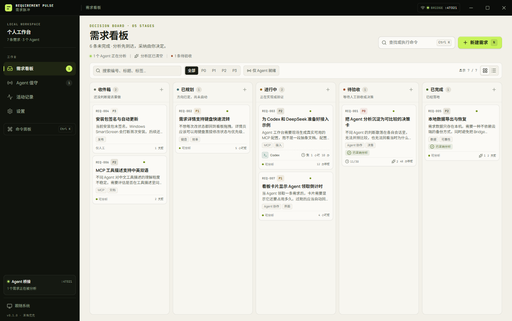
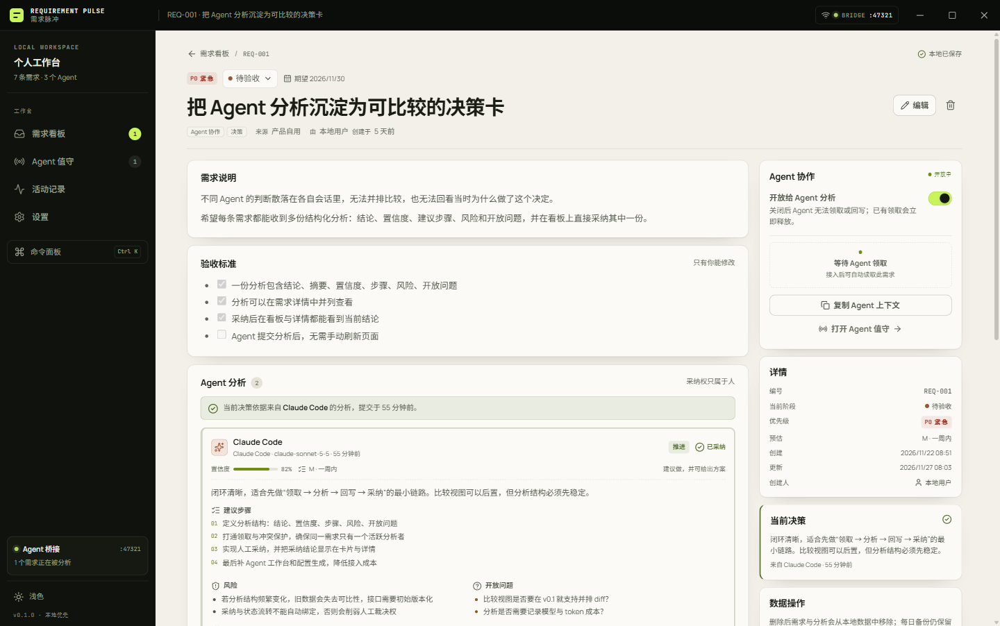
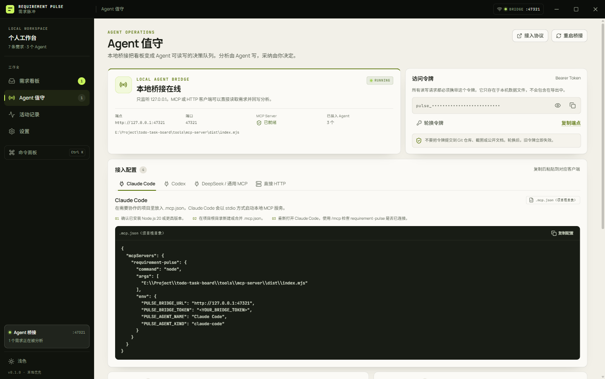
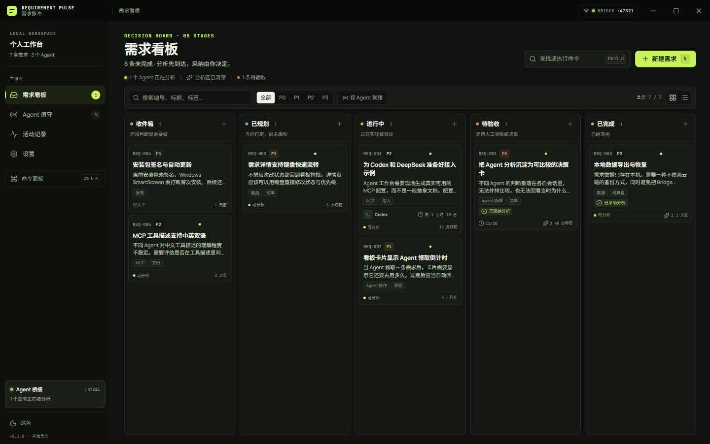

# Requirement Pulse · 需求脉冲

一个本地优先的 Windows 需求决策看板。需求不只是被记录：Claude Code、Codex、DeepSeek 等 Agent 可以读取需求、领取分析任务，并把结构化判断写回看板；是否采纳、需求标题与验收标准始终由人决定。



## 为什么做它

大多数任务板解决“事情有没有做”，却没有解决“这件事该不该做、为什么这样判断”。Requirement Pulse 把需求、Agent 分析、领取状态和人工决策放在同一个本地工作区里：

- **分析有结构**：结论、建议、置信度、工作量、步骤、风险、开放问题，而不是散落在聊天记录里。
- **判断有回路**：Agent 通过 MCP 工具领取需求、读取简报、回写分析；人比较分析并采纳其中一份。
- **决策可回看**：每次创建、移动、领取、分析、采纳都会进入活动记录。
- **数据在本地**：单个 `board.json`，原子写入、每日备份、可导出导入，不需要账号或云服务。

## 功能

- 五阶段看板：收件箱 → 已规划 → 进行中 → 待验收 → 已完成。
- 拖拽换列与键盘替代操作；列表视图；命令面板（`Ctrl K`）；完整键盘路径。
- 需求详情：Markdown 说明/验收标准、分析对比、评论、人工采纳、Agent 协作开关。
- Agent 领取：默认 90 分钟 TTL，冲突保护，分析提交后自动续领 30 分钟。
- Agent 值守：桥接状态、Token 轮换、Claude Code / Codex / 通用 MCP / HTTP 配置生成、Agent 名册。
- 浅色/深色主题、减少动态、Dialog 焦点管理、无障碍语义与可见焦点。
- 本地 JSON 存储、损坏文件隔离、导出不包含桥接 Token。

| 需求详情 | Agent 值守 |
| --- | --- |
|  |  |

<details>
<summary>深色主题</summary>



</details>

## 快速开始

要求：Windows 10/11 x64，Node.js **22 LTS**（最低 20），npm 10+。

```bash
npm install
npm run dev        # 开发模式，自动构建 MCP server
npm run build      # 类型检查 + 生产构建
npm run dist:win   # 生成 release/Requirement-Pulse-<version>-Setup.exe
npm start          # 预构建后以 Electron 预览
```

如果使用安装包，直接运行 `release/Requirement-Pulse-0.1.0-Setup.exe`。安装包未签名，Windows SmartScreen 可能要求确认；源码、构建脚本与产物都可自行复现。

> 某些 npm 配置会跳过 Electron 的安装脚本。若 `npm run dev` 报找不到 Electron，执行一次 `node node_modules/electron/install.js`。

## Agent 接入

### 1. 打开本地桥接

在应用内进入 **Agent 值守**，确认“本地桥接在线”，复制访问令牌。桥接只监听 `127.0.0.1`，不会暴露到局域网。

### 2. 使用 MCP（推荐）

应用会把 MCP stdio server 打包到安装目录：

```text
<安装目录>\resources\mcp-server\index.mjs
```

在 Agent 值守页直接复制对应客户端的配置。Claude Code 的项目级 `.mcp.json` 示例：

```json
{
  "mcpServers": {
    "requirement-pulse": {
      "command": "node",
      "args": ["C:\\Path\\To\\Requirement Pulse\\resources\\mcp-server\\index.mjs"],
      "env": {
        "PULSE_BRIDGE_URL": "http://127.0.0.1:47321",
        "PULSE_BRIDGE_TOKEN": "<从 Agent 值守页复制>",
        "PULSE_AGENT_NAME": "Claude Code",
        "PULSE_AGENT_KIND": "claude-code"
      }
    }
  }
}
```

源码开发时，路径为 `<repo>\tools\mcp-server\dist\index.mjs`，可用 `npm run mcp:build` 单独构建。`PULSE_AGENT_MODEL` 可选，用于在分析卡上显示模型。

MCP 工具：

| 工具 | 作用 |
| --- | --- |
| `pulse_board_summary` | 看板概览：阶段计数、Agent 就绪、活跃领取、待验收 |
| `pulse_list_requirements` | 按阶段、优先级、关键词、Agent 就绪筛选需求 |
| `pulse_get_requirement` | 读取完整需求、已有分析、评论和 Markdown 工作简报 |
| `pulse_claim_requirement` | 领取需求，避免多个 Agent 并发写入 |
| `pulse_release_requirement` | 释放领取 |
| `pulse_submit_analysis` | 回写结构化分析（支持 `idempotencyKey`） |
| `pulse_add_comment` | 添加评论 |
| `pulse_update_status` | 在设置许可时移动阶段 |

完整协议、HTTP 端点与推荐提示词见 [`docs/AGENT-PROTOCOL.md`](docs/AGENT-PROTOCOL.md)。

### 3. 直接 HTTP

不支持 MCP 的 harness 可以调用同一套本地 HTTP API：

```bash
curl -sS "http://127.0.0.1:47321/v1/requirements?agentReady=true" \
  -H "Authorization: Bearer $PULSE_TOKEN"
```

写请求使用 `application/json`，建议携带 `Idempotency-Key`。所有接口统一返回 `{ ok, data }` 或 `{ ok, error }`。

## 人与 Agent 的边界

| 动作 | 人 | Agent |
| --- | --- | --- |
| 读取需求、活动摘要 | ✅ | ✅（已开放的需求） |
| 领取 / 释放 | ✅ | ✅ |
| 提交分析、评论 | ✅ | ✅ |
| 采纳 / 取消采纳分析 | ✅ | ❌ |
| 编辑标题、描述、验收标准 | ✅ | ❌ |
| 修改阶段 | ✅ | 仅当设置允许 |
| 管理 Token、Agent 就绪、导入导出 | ✅ | ❌ |

分析只有被人采纳后才成为“当前决策依据”；Agent 提交分析不会自动推进需求，也不会覆盖验收标准。

## 数据与安全

- 数据文件：`board.json`，路径以应用 **设置 → 数据与备份** 显示为准（通常位于 `%APPDATA%\requirement-pulse\`）。
- 写入：临时文件 + 原子替换；启动时校验 schema，损坏文件会隔离到备份目录。
- 备份：每日自动备份，可通过设置页打开目录。
- 导出：需求、分析、评论、活动和外观设置；**不包含桥接 Token**。
- 导入：先备份当前数据，再整体替换；保留本机端口与 Token。
- 桥接：仅回环地址、Host 校验、Bearer Token 常量时间比较、无 CORS、请求体上限 512 KiB、写操作幂等键。

**不要把包含 Token 的 MCP 配置、截图或日志提交到 Git。** 项目本身的 `.gitignore` 已排除用户数据与构建产物。

## 开发与测试

```bash
npm run typecheck   # 主进程 / preload / MCP / 测试 + 渲染进程
npm test            # 23 个单元、桥接与 MCP 集成测试
npm run test:e2e    # Playwright 驱动真实 Electron：主流程、1024/1440 截图、axe 扫描
npm run smoke:packaged  # 需先 dist:win：验证打包版渲染、HTTP 与 8 个 MCP 工具
```

E2E 覆盖：看板渲染、键盘创建需求、命令面板导航、菜单换列、浅色/深色、主路由 axe（serious/critical 为 0）。已完成的运行时验证：

- Windows x64 安装包构建成功，`win-unpacked` 启动通过。
- 打包应用中 MCP 路径解析到 `resources/mcp-server/index.mjs`，HTTP health 正常，8 个 MCP 工具可列出并调用。
- 严格 CSP、沙箱、contextIsolation 开启；未打包与打包模式均无页面错误。

尚未验证：真实屏幕阅读器（NVDA/JAWS）、高对比度模式、非 100% 显示缩放下的拖拽手感，以及多显示器热插拔。详见 [`docs/IMPLEMENTATION-PLAN.md`](docs/IMPLEMENTATION-PLAN.md) 的验证记录。

## 项目结构

```text
src/main/            Electron 主进程、JSON 存储、领域服务、HTTP 桥接、IPC
src/preload/         contextBridge 类型化 API
src/renderer/        React 19 界面、路由、看板、详情、Agent 值守、设置
src/shared/types.ts  数据模型、状态元数据、IPC 类型
tools/mcp-server/    stdio MCP server（esbuild 打包为单文件）
tests/               单元 / 桥接 / MCP 集成 / Electron E2E
docs/                产品设计、技术设计、实施计划、Agent 协议
build/               应用图标与打包资源
```

## 设计文档

- [产品设计](docs/PRODUCT-DESIGN.md)
- [技术设计](docs/TECHNICAL-DESIGN.md)
- [实施计划](docs/IMPLEMENTATION-PLAN.md)
- [Agent 接入协议](docs/AGENT-PROTOCOL.md)

## License

[MIT](LICENSE) © 2026 Harvey Xia
