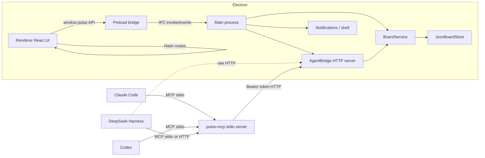

# Requirement Pulse · 技术设计

> 状态：技术基线 v0.1  
> 日期：2026-11-26  
> 关联：[产品与界面设计](./PRODUCT-DESIGN.md) · [实施计划](./IMPLEMENTATION-PLAN.md) · [Agent 接入协议](./AGENT-PROTOCOL.md)

---

## 1. 目标与约束

### 1.1 技术目标

- Windows 桌面应用，单机运行，离线可用。
- 本地需求数据可靠持久化，崩溃/断电风险下可恢复。
- Agent 可在不接触应用内部实现的情况下，通过稳定的本地协议读取需求、领取、提交分析、评论、更新状态。
- 人类 UI 对 Agent 的写入实时可见；人保留最终决策权。
- 零原生 Node 扩展依赖，降低 Electron 打包与跨机器安装风险。
- 公开仓库可审计、可复现构建，无隐藏服务。

### 1.2 关键约束

- Electron + React + TypeScript。
- 数据仅存本机 `%APPDATA%/Requirement Pulse/`（Windows）。
- Bridge 仅绑定 `127.0.0.1`，必须 Bearer Token。
- 不内嵌 LLM SDK、不代替 Claude Code/Codex/DeepSeek 的执行环境。
- v0.1 为单实例、单用户；不做账号、云同步、多人并发。
- Windows 是目标平台；代码尽量跨平台，不承诺 macOS/Linux 安装包。

---

## 2. 架构总览



### 2.1 进程职责

| 层 | 职责 | 明确不做 |
| --- | --- | --- |
| Main | 窗口生命周期、数据持久化、领域交易、Agent Bridge、IPC、导入导出、通知 | 不渲染 UI；不执行用户代码；不调用外部 LLM |
| Preload | 用 `contextBridge` 暴露窄 API；IPC 类型桥接 | 不暴露 Node fs / ipcRenderer 原对象 |
| Renderer | React 视图、本地筛选、命令面板、乐观拖拽、Toast | 不直接读写文件；不持有 Node 权限 |
| MCP server | stdio MCP 协议，转发到 AgentBridge | 不直接访问 board 文件；不知道 Token 以外的秘密 |
| AgentBridge | 认证、路由、输入校验、超时/幂等、错误映射 | 不绕过 BoardService 的领域规则 |

### 2.2 为什么不用 SQLite

v0.1 规模（单用户，最多数千需求 + 审计记录）和查询模式（读全量、客户端过滤）允许使用一个 JSON 文档存储：

- 零原生模块，不需要 `electron-rebuild`，不会因为 Node/Electron ABI 在小版本升级后炸掉。
- 数据文件可直接备份、导出、diff、人工修复。
- 通过串行化写入 + 临时文件 rename 实现原子提交。
- 内存中的完整快照简化 UI 实时刷新和 Agent API 的一致性。
- 代价：没有 SQL 索引/事务/部分更新；用领域服务约束、内存过滤、有界审计记录换取可移植性。

如果未来需求规模/并发增长，可迁移到 SQLite；领域模型和 API 契约不依赖存储实现，迁移范围限 `JsonBoardStore`。

---

## 3. 工程结构

```text
requirement-pulse/
├─ docs/
├─ build/                     # 图标与打包资源
├─ src/
│  ├─ main/
│  │  ├─ index.ts             # app/window lifecycle
│  │  ├─ ipc.ts               # IPC handlers
│  │  ├─ store.ts             # JsonBoardStore
│  │  ├─ service.ts           # BoardService domain operations
│  │  ├─ bridge.ts            # localhost HTTP API
│  │  ├─ schemas.ts           # zod input/persistence schemas
│  │  ├─ seed.ts              # first-run sample workspace
│  │  ├─ notifications.ts
│  │  ├─ paths.ts
│  │  └─ windowState.ts
│  ├─ preload/
│  │  ├─ index.ts
│  │  └─ index.d.ts
│  ├─ renderer/
│  │  ├─ index.html
│  │  └─ src/
│  │     ├─ App.tsx
│  │     ├─ main.tsx
│  │     ├─ routes/
│  │     ├─ components/
│  │     ├─ store/
│  │     ├─ lib/
│  │     └─ styles/
│  └─ shared/
│     ├─ constants.ts
│     ├─ types.ts
│     └─ format.ts
├─ tools/mcp-server/
│  ├─ src/index.ts
│  ├─ src/api.ts
│  └─ README.md
├─ tests/
│  ├─ unit/
│  ├─ bridge/
│  └─ e2e/
├─ electron.vite.config.ts
├─ electron-builder.yml
├─ vitest.config.ts
├─ playwright.config.ts
└─ package.json
```

---

## 4. 数据模型

### 4.1 持久化文件

Windows 路径：

```text
%APPDATA%/Requirement Pulse/
├─ board.json                 # 主数据
├─ window-state.json          # 窗口位置/尺寸/最大化
└─ backups/
   ├─ board-20261126-213000.json
   └─ corrupt-20261126-220000.json
```

`board.json`：

```jsonc
{
  "schemaVersion": 1,
  "createdAt": "2026-11-26T12:00:00.000Z",
  "updatedAt": "2026-11-26T12:00:00.000Z",
  "nextRequirementSequence": 6,
  "requirements": [ /* Requirement[] */ ],
  "activities": [ /* Activity[]，最多 1000 条内存记录 */ ],
  "agents": [ /* AgentRecord[] */ ],
  "settings": {
    "theme": "system",
    "userName": "本地用户",
    "bridgePort": 47321,
    "bridgeEnabled": true,
    "allowAgentStatusUpdates": true,
    "notifyOnAgentAnalysis": true,
    "bridgeToken": "base64url...",
    "seeded": true
  }
}
```

Token 属于本机秘密，不包含在导出文件与快照的“可分享数据”中。UI 通过受控 IPC 获取给配置面板。

### 4.2 TypeScript 领域模型

```ts
type RequirementStatus = 'inbox' | 'planned' | 'building' | 'review' | 'done';
type Priority = 'critical' | 'high' | 'medium' | 'low';
type AnalysisRecommendation = 'proceed' | 'needs-info' | 'defer' | 'decline';
type ActorKind = 'human' | 'agent' | 'system';

interface AgentRef {
  name: string;
  kind: 'claude-code' | 'codex' | 'deepseek' | 'generic' | string;
  model?: string;
}

interface Claim {
  agent: AgentRef;
  claimedAt: string;   // ISO
  expiresAt: string;   // ISO
}

interface Analysis {
  id: string;
  agent: AgentRef;
  summary: string;
  recommendation: AnalysisRecommendation;
  confidence?: number;         // 0..100
  estimatedEffort?: string;    // free text, UI default XS/S/M/L/XL
  proposedSteps: string[];
  risks: string[];
  openQuestions: string[];
  notes?: string;              // markdown
  createdAt: string;
  idempotencyKey?: string;
}

interface Comment {
  id: string;
  author: { kind: ActorKind; name: string };
  body: string;                // markdown
  createdAt: string;
  idempotencyKey?: string;
}

interface Requirement {
  id: string;                  // UUID
  code: string;                // REQ-001
  title: string;
  description: string;         // markdown
  acceptanceCriteria: string;  // markdown checklist
  status: RequirementStatus;
  priority: Priority;
  tags: string[];
  source?: string;
  effort?: string;
  dueDate?: string;            // YYYY-MM-DD
  agentReady: boolean;
  claim: Claim | null;
  order: number;               // status-local ordering
  analyses: Analysis[];
  comments: Comment[];
  acceptedAnalysisId: string | null;
  createdBy: string;           // human display name at creation
  createdAt: string;
  updatedAt: string;
  completedAt: string | null;
}

interface Activity {
  id: string;
  type:
    | 'requirement.created'
    | 'requirement.updated'
    | 'requirement.status_changed'
    | 'requirement.deleted'
    | 'requirement.agent_ready_changed'
    | 'analysis.submitted'
    | 'analysis.accepted'
    | 'analysis.unaccepted'
    | 'comment.added'
    | 'claim.created'
    | 'claim.released'
    | 'claim.expired'
    | 'bridge.started'
    | 'bridge.stopped'
    | 'data.exported'
    | 'data.imported';
  actor: { kind: ActorKind; name: string; agentKind?: string };
  requirementId?: string;
  requirementCode?: string;
  message: string;
  metadata?: Record<string, unknown>;
  createdAt: string;
}

interface AgentRecord {
  key: string;                // normalized kind:name (lowercase)
  name: string;
  kind: string;
  model?: string;
  firstSeenAt: string;
  lastSeenAt: string;
  analysisCount: number;
  commentCount: number;
}

interface Settings {
  theme: 'system' | 'light' | 'dark';
  userName: string;
  bridgePort: number;
  bridgeEnabled: boolean;
  allowAgentStatusUpdates: boolean;
  notifyOnAgentAnalysis: boolean;
  bridgeToken: string;
  seeded: boolean;
}
```

### 4.3 约束与不变量

- `title` trim 后 1–160 字符。`description` / `acceptanceCriteria` 最大 40,000 字符。
- 标签 0–8 个；每个 1–32 字符；去重、trim。
- 分析摘要 1–4,000 字符；数组每项 1–1,000 字符，最多各 12 项。`notes` 最多 20,000 字符。
- 评论 1–10,000 字符。
- Agent 名称 1–80；kind 1–40；model 0–80。
- 领取 TTL 15–240 分钟，默认 90 分钟。
- 同一需求最多一个有效 claim；过期 claim 在写操作/读取时为失效语义。
- `acceptedAnalysisId` 必须指向需求内存在的分析，或为 null；采纳不删除其他分析。
- `code` 在 workspace 内唯一，按 `nextRequirementSequence` 递增，删除后不复用。
- `order` 仅在所属状态内比较；移动后重排为稳定的 0..n-1。
- 活动记录最多 1000 条，超出从最旧处裁剪；UI 快照返回最新 200 条。
- 删除需求会同时删除其分析/评论/领取，但保留一条 `requirement.deleted` 审计事件（不含正文）。
- Token 长度 ≥32 字节随机；仅本机存储；导入不覆盖现有 Token。

### 4.4 迁移

`schemaVersion: 1`。读取时：

1. 解析 JSON。
2. 若版本低于当前，运行顺序迁移函数（v0.1 暂无）。
3. 用 zod 校验；失败则备份并创建空数据/种子数据。
4. 未知字段默认剥离并记录警告（不拒绝加载，除非核心字段缺失）。

---

## 5. 领域服务 BoardService

`BoardService` 是唯一可以改变 board 状态的入口，Main IPC 与 AgentBridge 都调用它。

### 5.1 方法

```ts
class BoardService extends EventEmitter {
  getSnapshot(): BoardSnapshot;
  createRequirement(input, actor): Requirement;
  updateRequirement(id, patch, actor): Requirement;
  moveRequirement(id, targetStatus, targetIndex, actor): Requirement;
  deleteRequirement(id, actor): void;
  addComment(id, body, actor, idempotencyKey?): Comment;
  acceptAnalysis(id, analysisId | null, actor): Requirement;
  claimRequirement(id, agent, ttlMinutes?): Claim;
  releaseClaim(id, agent, actor): Requirement;
  submitAnalysis(id, input, agent, idempotencyKey?): Analysis;
  updateRequirementStatusByAgent(id, status, agent): Requirement;
  updateSettings(patch): Settings;
  rotateToken(): string;
  importData(payload): void;
  exportData(): ExportPayload;
  getBrief(id): string;
}
```

### 5.2 事件

- `changed`：任何持久化状态变化后发出，携带 `BoardSnapshot`。
- `analysis:created`：携带需求 + 分析；Main 用于桌面通知。
- `bridge:status`：Bridge 启停/错误。
- 事件只用于通知/UI 刷新，不能用于业务决策；状态由 store 中的最新数据决定。

### 5.3 交易语义

- 每个写方法在内存中完成校验与变更，然后调用 store `commit()`。
- Store 把写操作串行化到 Promise 链，生成新的 `updatedAt`，写入临时文件，`rename` 原子替换。
- 写入成功后才 emit `changed`；UI 不会看到未持久化的状态（IPC 返回前完成 commit）。
- 乐观 UI 与主进程冲突时，以主进程返回快照为准。

### 5.4 排序

- 新建：放入目标状态末尾（`order = max+1`）。
- 移动：
  - 同状态：从旧位置移除，插入 `targetIndex`，所有受影响的项重新编号。
  - 跨状态：旧状态其余项压缩；目标状态插入并重新编号；`completedAt` 在进入 `done` 时设为当前时间，离开时清空。
- 返回的快照中 requirement 默认按 `code` 稳定排序；UI 按列/order 分组。

### 5.5 领取

```text
claim(id, agent, ttl):
  if !requirement.agentReady → 409 AGENT_NOT_READY
  if status === done → 409 REQUIREMENT_DONE
  if existing claim active:
    if same agent key → 刷新 expiresAt 并返回
    else → 409 CLAIM_CONFLICT (含现有 agent)
  set claim; record activity claim.created
```

Agent 身份 key = `${kind}:${name}` 小写 trim。model 不参与锁。

`isClaimActive(claim, now)` 判断 `expiresAt > now`。读取快照时**不写盘**清理过期 claim；任何写操作开始时清理该需求的过期 claim，并记录 `claim.expired`（惰性清理）。UI 按当前时间隐藏过期状态。这样避免定时器频繁写盘。

### 5.6 提交分析

```text
submitAnalysis(id, input, agent, idempotencyKey):
  requirement = get(id)
  if !requirement.agentReady → 409 AGENT_NOT_READY
  if existing claim active by another agent → 409 CLAIM_CONFLICT
  if !claim active → acquire short claim (30 min) for agent? 见下
  if idempotencyKey already used → return existing analysis (200)
  validate input
  append analysis; register agent record; record activity
  return analysis
```

设计选择：**没有活动领取时，提交分析会自动为该 Agent 创建一个 30 分钟 claim**，保证一次提交的原子性和“有 Agent 在写”的可见性；已有他人有效领取则拒绝。MCP 工作流依然会显式先 `claim`，自动 claim 只是容错。分析提交不会自动释放 claim：Agent 可能继续评论/更新状态，用户可在 UI 释放。

同一需求内的 `idempotencyKey` 存在分析上；重复请求返回原分析，不新增活动。Token 级限流为未来扩展，v0.1 本机单用户不实现。

### 5.7 状态更新（Agent）

- 仅当 `settings.allowAgentStatusUpdates === true`。
- 只允许修改 `status`；其他字段（标题、描述、优先级、标签、验收标准、采纳）拒绝 403。
- 状态更新会写 `requirement.status_changed`，actor 为 Agent。
- 若 Agent 把需求置为 `done`，不自动采纳分析；`completedAt` 照常设置。
- 人可在设置关闭该能力；关闭后已有 Agent 调状态返回 403。

### 5.8 采纳

- 人类专属；Agent API 无此端点。
- `acceptAnalysis(id, null)` 取消采纳；`acceptAnalysis(id, analysisId)` 要求分析存在。
- 换采纳对象时，新 id 直接替换旧 id；活动记录旧/新。
- 删除需求时直接移除，无需先取消。

### 5.9 活动

- 每次状态变更、分析提交、采纳、领取、评论、删除都生成 activity。
- 中文 `message` 是给人看的摘要；`metadata` 用于结构化诊断，不直接渲染 HTML。
- 修改标题/描述等记录 `requirement.updated`，metadata 包含字段名，不存旧正文（隐私与体积）。
- Activity 是追加日志，不提供编辑/删除（随需求删除的功能事件保留摘要）。

---

## 6. Agent Bridge HTTP API

### 6.1 网络与安全

- 默认监听 `127.0.0.1:47321`，可配置端口 1024–65535。
- 不监听 `0.0.0.0`，不支持局域网访问。
- 认证：`Authorization: Bearer <token>`。
- 对 `Host` 头校验：只允许 `127.0.0.1:<port>` / `localhost:<port>` / `[::1]` 对应形式；拒绝陌生 Host，缓解 DNS rebinding。
- 请求体上限 512 KiB；超过返回 413。
- 所有写请求要求 `Content-Type: application/json`（GET/HEALTH 除外）。
- 不设置 `Access-Control-Allow-Origin`；浏览器跨域读取默认被阻止。MCP/命令行客户端不受 CORS 限制。
- Token 不出现在 URL 中。
- 不记录 Token、请求体正文；错误日志仅记录路由、状态、错误码。
- 仅允许 GET / POST / PATCH / DELETE；其他 405。
- 同一 process 重启后 token 保留；用户可手动轮换，旧 token 立即失效。

### 6.2 版本化

基础路径 `/v1`。响应统一：

```json
{ "ok": true, "data": {} }
```

错误：

```json
{
  "ok": false,
  "error": {
    "code": "CLAIM_CONFLICT",
    "message": "需求已被 Codex 领取",
    "details": { "claimedBy": "Codex", "expiresAt": "..." }
  }
}
```

错误码：

| HTTP | code | 说明 |
| --- | --- | --- |
| 400 | `VALIDATION_ERROR` | 字段校验失败，details 含路径 |
| 401 | `UNAUTHORIZED` | Token 缺失/错误 |
| 403 | `AGENT_UPDATES_DISABLED` | Agent 改状态被设置禁止 |
| 404 | `NOT_FOUND` | 需求/分析不存在 |
| 405 | `METHOD_NOT_ALLOWED` | — |
| 409 | `CLAIM_CONFLICT` / `AGENT_NOT_READY` / `REQUIREMENT_DONE` | 状态冲突 |
| 413 | `PAYLOAD_TOO_LARGE` | — |
| 500 | `INTERNAL_ERROR` | 未预期错误；不泄露堆栈给 Agent |

### 6.3 端点

| 方法 | 路径 | 说明 | 认证 |
| --- | --- | --- | --- |
| GET | `/v1/health` | Bridge 存活与版本 | 否 |
| GET | `/v1/board` | 看板摘要（计数、活跃领取、Agent） | 是 |
| GET | `/v1/requirements` | 需求摘要列表，支持筛选 | 是 |
| GET | `/v1/requirements/:id` | 单个需求完整对象（含分析/评论） | 是 |
| GET | `/v1/requirements/:id/brief` | Markdown 简报，适合塞进 Agent 上下文 | 是 |
| POST | `/v1/requirements/:id/claim` | 领取 | 是 |
| DELETE | `/v1/requirements/:id/claim` | 释放领取 | 是 |
| POST | `/v1/requirements/:id/analyses` | 提交分析 | 是 |
| POST | `/v1/requirements/:id/comments` | 提交评论 | 是 |
| PATCH | `/v1/requirements/:id` | 仅更新 `status`（受设置限制） | 是 |
| GET | `/v1/activity` | 最近活动（可选 limit） | 是 |

`GET /v1/requirements` 查询参数：

- `status`：`inbox|planned|building|review|done`
- `priority`：`critical|high|medium|low`
- `agentReady`：`true|false`
- `q`：大小写不敏感，对 code/title/description/tags 进行子串匹配
- `limit`：1–200，默认 50
- `updatedSince`：ISO 时间；过滤 `updatedAt >`
- `sort`：`updated|priority|code`，默认 `updated`

返回摘要字段：`id, code, title, status, priority, tags, agentReady, claim, analysisCount, acceptedAnalysisId, updatedAt, dueDate`。

#### 领取示例

```http
POST /v1/requirements/8d.../claim
Authorization: Bearer <token>
Content-Type: application/json

{
  "agent": { "name": "Claude Code", "kind": "claude-code", "model": "claude-sonnet-5-5" },
  "ttlMinutes": 90
}
```

成功：

```json
{
  "ok": true,
  "data": {
    "claim": { "agent": { "...": "..." }, "claimedAt": "...", "expiresAt": "..." },
    "requirement": { "id": "...", "code": "REQ-003", "status": "planned" }
  }
}
```

#### 提交分析示例

```http
POST /v1/requirements/8d.../analyses
Authorization: Bearer <token>
Idempotency-Key: 9fbb4f1e-agent-run-001
Content-Type: application/json

{
  "agent": { "name": "Claude Code", "kind": "claude-code", "model": "claude-sonnet-5-5" },
  "summary": "需求边界清楚，适合先做只读的 Bridge 和可采纳分析卡。",
  "recommendation": "proceed",
  "confidence": 78,
  "estimatedEffort": "M",
  "proposedSteps": [
    "先实现需求读取与领取协议",
    "实现分析提交与人工采纳",
    "再补单测和 MCP 配置生成"
  ],
  "risks": [
    "本地令牌保存在用户目录，需要明确不进入导出文件"
  ],
  "openQuestions": [
    "是否需要支持多个分析之间的 diff？"
  ],
  "notes": "**建议**：先打通闭环，再优化比较视图。"
}
```

- 成功 `201`，返回 `analysis` 与更新后的需求摘要。
- `Idempotency-Key` 可选，推荐由 Agent 生成；同一需求重复键返回 `200` 与原分析。

#### 需求简报（Markdown）

内容：

```markdown
# REQ-003 · Agent 接入模板
状态：已规划 · 优先级：P1 · 标签：Agent, MCP
开放给 Agent：是
创建：2026-11-26 · 更新：2026-11-26

## 需求描述
...

## 验收标准
...

## 已有分析
### Claude Code · 推进 · 72%
...

## 工作协议
1. 领取...
2. 提交分析（pulse_submit_analysis）...
...
```

简报是幂等、只读、轻量文本，MCP 工具和 UI 复制按钮共用同一生成器（Main 中）。

### 6.4 幂等与冲突

- `Idempotency-Key` 作为分析的可选字段，最大 120 字符；不存在唯一索引，由领域服务在需求范围内线性查找。
- 同一键 + 同一 Agent → 返回既有分析；不同 Agent 使用同键 → 仍冲突拒绝（避免跨 Agent 覆盖语义）。
- 不做全 API 的 exactly-once；其他写操作依靠领取与 TTL 协作。

### 6.5 Bridge 生命周期

- 启动：读取 settings（enabled, port, token）→ `http.createServer` → 监听。
- 端口占用：捕获 `EADDRINUSE`，状态置 `error`，不静默换端口；UI 提示改端口。
- 停止：关闭 server、清理连接；不删除 token。
- 端口或 token 变更：先 stop → 更新 settings → start；失败时保留设置并显示错误。
- 应用退出：停止 Bridge，等待 store 最后一次写入完成。
- Bridge 状态不持久化；每次启动根据 `bridgeEnabled` 重新启动。

---

## 7. MCP Server

### 7.1 形态

- TypeScript 源码 `tools/mcp-server/src`，esbuild 打包为单文件 ESM：`tools/mcp-server/dist/index.mjs`。
- 打包进 Electron `resources/mcp-server/index.mjs`。
- 由 Agent 用 `node` 启动（Node ≥20），通过 stdio 使用 MCP。
- 依赖环境变量：
  - `PULSE_BRIDGE_URL` 默认 `http://127.0.0.1:47321`
  - `PULSE_BRIDGE_TOKEN` 必填
  - `PULSE_AGENT_NAME` 默认 `MCP Agent`
  - `PULSE_AGENT_KIND` 默认 `generic`
  - `PULSE_AGENT_MODEL` 可选

### 7.2 工具

| 工具 | 参数 | 行为 |
| --- | --- | --- |
| `pulse_board_summary` | 无 | 返回计数、活跃领取、Agent |
| `pulse_list_requirements` | status?, priority?, agentReady?, q?, limit? | 返回摘要列表 |
| `pulse_get_requirement` | id（支持 code 或 UUID） | 返回完整需求 + 简报 Markdown |
| `pulse_claim_requirement` | id, ttlMinutes? | 领取 |
| `pulse_release_requirement` | id | 释放 |
| `pulse_submit_analysis` | id, summary, recommendation, confidence?, estimatedEffort?, proposedSteps[], risks[], openQuestions[], notes? | 提交分析 |
| `pulse_add_comment` | id, body | 评论 |
| `pulse_update_status` | id, status | 改状态（服务端许可检查） |

- 所有工具的描述都明确：先读取，分析前领取，分析后回写，不要修改代码文件。
- `pulse_get_requirement` 同时返回 `briefMarkdown`，方便 Agent 直接使用。
- 输入用 zod 在 MCP 端做第一层校验；Bridge 端再做权威校验。
- 输出为文本化 JSON（MCP `content: [{type:"text", text}]`），对错误设置 `isError: true`；包含 HTTP 状态与错误码，便于 Agent 自纠。
- 不提供删除、采纳、修改标题/描述、读取文件系统、执行命令等工具。

### 7.3 Agent 指南（内置 instructions）

MCP server 的 `instructions` 字段写清：

1. 只能通过提供的工具操作需求。
2. 深度分析前先领取；冲突时停止并向用户说明。
3. 输出结构化分析，明确事实、假设、风险、开放问题。
4. 不要编造客户数据/预算/排期；缺信息就使用 `needs-info`。
5. 不自动实现代码；本工具只回写分析。
6. 完成后释放领取；任何写操作都使用自己的 Agent 名称。

### 7.4 配置生成

UI 根据运行时路径/端口/token 生成：

- Claude Code：项目 `.mcp.json` 或 `claude mcp add` 命令模板。
- Codex：`~/.codex/config.toml` 模板。
- DeepSeek Harness：通用 MCP `mcpServers` JSON；若 harness 支持 MCP，按同样字段适配。
- 裸 HTTP：`curl` 示例。

路径转义用 JSON.stringify / TOML 基本字符串处理，避免 Windows 反斜杠问题。不得写死开发机路径。

---

## 8. 快照与 IPC

### 8.1 快照

主进程向 Renderer 推送：

```ts
interface AppSnapshot {
  data: {
    requirements: Requirement[];
    activities: Activity[];
    agents: AgentRecord[];
    settings: PublicSettings;   // bridgeToken 仅在 bridge 子对象单独提供
    nextRequirementSequence: number;
  };
  bridge: {
    running: boolean;
    starting?: boolean;
    port: number;
    url: string;
    token: string;               // 本地 UI 需要展示/复制；不进入任何外部通道
    mcpServerPath: string;
    mcpServerReady: boolean;
    error?: string;
  };
  paths: {
    userData: string;
    boardFile: string;
    backupsDir: string;
  };
  app: {
    version: string;
    platform: string;
    isPackaged: boolean;
  };
}
```

- 快照包含全量需求与最近 200 条动态、Agent 记录。
- 读请求不走 HTTP，UI 只通过 IPC。
- 每次变更后主进程广播快照；不做差量合并，v0.1 数据量可接受。
- Renderer 只需维护一个快照 store。

### 8.2 IPC 频道

| 频道 | 方向 | 说明 |
| --- | --- | --- |
| `app:getSnapshot` | invoke | 获取初始/刷新快照 |
| `app:onSnapshot` | main → renderer | 广播最新快照 |
| `app:onNavigate` | main → renderer | 通知点击后跳转需求 |
| `requirement:create` | invoke | 创建 |
| `requirement:update` | invoke | 更新元数据 |
| `requirement:move` | invoke | 状态+排序 |
| `requirement:delete` | invoke | 删除 |
| `requirement:addComment` | invoke | 评论 |
| `requirement:acceptAnalysis` | invoke | 采纳/取消采纳 |
| `settings:update` | invoke | 更新设置 |
| `bridge:restart` | invoke | 开始/停止/重启 |
| `bridge:rotateToken` | invoke | 轮换 token |
| `data:export` / `data:import` / `data:openFolder` | invoke | 文件操作 |
| `clipboard:write` | invoke | 带长度上限的复制兜底（renderer 优先 navigator.clipboard） |
| `external:open` | invoke | 仅 http/https |
| `window:minimize` / `window:toggleMaximize` / `window:close` | invoke | 窗口控制 |
| `window:stateChanged` | main → renderer | maximized 状态变化 |

所有 invoke 参数在 Main 端用 zod 校验；错误序列化为 `{ code, message, details? }`，Renderer 转 toast。

### 8.3 Preload 暴露

```ts
window.pulse = {
  getSnapshot,
  onSnapshot,
  onNavigate,
  createRequirement,
  updateRequirement,
  moveRequirement,
  deleteRequirement,
  addComment,
  acceptAnalysis,
  updateSettings,
  restartBridge,
  rotateToken,
  exportData,
  importData,
  openDataFolder,
  writeClipboard,
  openExternal,
  window: { minimize, toggleMaximize, close, onMaximizedChange }
};
```

- 不暴露 `ipcRenderer`、`process`、`fs`。
- `contextIsolation: true`、`nodeIntegration: false`、`sandbox: true`。
- CSP：默认仅自身、字体本地、无远程脚本；连接仅允许本地/开发 HMR。
- 拦截 `will-navigate` 与 `setWindowOpenHandler`，外链只允许 http/https 并交给系统浏览器。

---

## 9. Renderer 设计

### 9.1 技术栈

- React 19 + TypeScript + Vite（electron-vite）。
- HashRouter（`file://` 打包可用）。
- Zustand：UI/快照单一 store。
- Radix UI primitives：Dialog、AlertDialog、DropdownMenu、Popover、Tabs、Switch、Tooltip、Select（按需）。
- `@dnd-kit/core` + `@dnd-kit/sortable`：可访问拖拽。
- `cmdk`：命令面板。
- `react-markdown` + `remark-gfm`：需求描述/分析备注/评论。
- `lucide-react`：图标。
- 自定义 CSS + CSS 变量；不使用 Tailwind，避免默认设计语汇。
- 字体：`@fontsource-variable/manrope`、`@fontsource-variable/noto-sans-sc`、`@fontsource-variable/jetbrains-mono`。

### 9.2 状态管理

```ts
useAppStore: {
  snapshot: AppSnapshot | null;
  status: 'loading' | 'ready' | 'error';
  error: string | null;
  initialize(): Promise<void>;
  applySnapshot(snapshot): void;
  refresh(): Promise<void>;
  optimisticMove(id, status, index): void;
  rollback(): void;
}
useUiStore: {
  commandOpen: boolean;
  dialog: { type: 'create'|'edit'; requirementId?: string; presetStatus?: Status } | null;
  confirmDeleteId: string | null;
  toasts: Toast[];
  ...
}
```

- `App` 初始化调用 `getSnapshot()`，并订阅 `onSnapshot`；清理时移除监听。
- 视图筛选、排序、视图模式是 Renderer 本地状态，不写盘（视图模式写 localStorage）。
- 操作 helper：调用 IPC → 主进程返回新快照 → `applySnapshot`；不需要重新拉取。
- 错误统一转 toast；表单错误保持本地。
- 当前时间 hook：全局 30s tick，用于领取倒计时、相对时间；页面隐藏时暂停（visibilitychange）。

### 9.3 路由

```text
#/                       Board
#/requirement/:id        Detail
#/agents                 Agent Desk
#/activity               Activity
#/settings               Settings
*                        NotFound
```

- 返回看板时恢复滚动位置：渲染前读取 sessionStorage 的 `board-scroll-{view}`，或保持 Board 组件挂载在 Router layout 中？使用路由时组件卸载。简单方案：在 navigate 时保存 `boardScrollY`，Board 挂载后恢复；不能保证 dnd 滚动容器恢复。v0.1 可接受回到顶部，但设计希望保留。技术计划使用 `sessionStorage` + `useLayoutEffect` 恢复主列滚动。
- 详情页在快照更新时按 id 重新推导，不本地复制可编辑副本。

### 9.4 Markdown 安全

- `react-markdown` 不使用 `rehype-raw`，不渲染原始 HTML。
- 链接只允许 http/https；点击统一 `window.pulse.openExternal`，阻止默认导航。
- 图片不自动加载外部资源（v0.1 Markdown 渲染图片时可阻止或仅显示链接，防止跟踪；文档中说明）。
- 代码块风格与等宽字体。

### 9.5 DnD 细节

- `DndContext` 包住 board；`PointerSensor` activationDistance 6；`KeyboardSensor` with sortableKeyboardCoordinates。
- 每列一个 `SortableContext`，按 `order` 排序。
- `onDragEnd`：
  - 若 over 是卡片：目标状态 = 该卡片状态，index = 其在目标列的顺序。
  - 若 over 是列容器：目标状态 = 列状态，index = 末尾。
  - 计算是否变化；调用 `moveRequirement`。
- 乐观更新需求状态/order，失败回滚。拖拽结束后焦点回到被移动卡片的手柄。
- 每张卡片同时提供菜单“移动到…”；不依赖 DnD 可操作。

### 9.6 命令面板与快捷键

- 全局 `keydown`（capture）：Ctrl/Cmd+K 打开，Ctrl/Cmd+N 新建。
- 在 Dialog 已打开时不重复触发。
- `cmdk` 的 filter 自定义为中文/编号/标题模糊搜索（简单 includes + 拼音不做）。
- 输入法组合期不处理 Enter。
- 命令动作：
  - 新建需求
  - 打开 Agent 工作台
  - 打开动态
  - 切换主题（在 light/dark 间，system 由设置保留）
  - 导出数据
  - 需求跳转

### 9.7 UI 与数据解耦

- 页面组件不直接调用 `window.pulse`；通过 `lib/actions.ts`，便于测试与错误处理。
- 纯展示组件接收数据与回调；状态变更由页面调用 actions。
- 组件测试以 Testing Library（可选）覆盖：状态 chip、空状态、错误呈现、Dialog 未保存逻辑；e2e 覆盖主流程。

---

## 10. 窗口、主题、通知

### 10.1 窗口

- BrowserWindow：`frame: false`、`titleBarStyle: 'hidden'`（Windows 下 frameless）、`backgroundColor` 随主题、`minWidth: 1024`、`minHeight: 720`、`show: false` 至 ready-to-show。
- 自定义窗口按钮通过 IPC 控制；监听 `maximize/unmaximize` 更新状态。
- 窗口位置/大小存 `window-state.json`；还原前校验至少在某个显示器可见，防止离屏。
- 单实例：`app.requestSingleInstanceLock()`；第二次启动聚焦已有窗口。
- 外链/导航拦截。
- `webPreferences`: `preload`、`contextIsolation: true`、`sandbox: true`、`nodeIntegration: false`、`webSecurity: true`。

### 10.2 主题

- Renderer 侧设置 `document.documentElement.dataset.theme = resolved`。
- 设置值 `system` 时通过 `matchMedia('(prefers-color-scheme: dark)')` 解析，监听变化。
- 主进程监听主题设置更新窗口 `backgroundColor`（避免 frameless 边缘闪白）。
- 初始 HTML 内联脚本从 `localStorage` 读取 cached resolved theme 先着色，再接收主进程快照覆盖。
- 原生下拉/滚动条使用 `color-scheme: light dark` 对应主题。

### 10.3 通知

- 新分析且窗口未聚焦时，`Notification`：标题 `Agent 分析已到达`，正文 `Claude Code · REQ-003 · 推进`。点击聚焦窗口并发送 `app:onNavigate` 到 `#/requirement/:id`。
- 受 `notifyOnAgentAnalysis` 控制。
- 不发送评论/状态变更通知，避免噪音。
- Windows 通知要求 AppUserModelID；设置 `app.setAppUserModelId('com.harveyxiacn.requirementpulse')`。

---

## 11. 持久化与恢复

### 11.1 写入流程

```text
mutate in memory
  → clone data
  → write backups/board-YYYYMMDD-HHmmss.json if last backup > 24h (or first boot)
  → fs.writeFile(board.json.tmp, JSON)
  → fs.rename(tmp, board.json)  // atomic on same volume
  → emit changed
```

- 内存中的 mutation 在写盘失败时需要回滚：服务层先对当前数据 `structuredClone` 建立快照，commit 失败则恢复快照并抛错，UI 状态不会变脏。
- 写入队列串行化，避免两个 API 同时 rename。
- 启动时如果 `board.json` 缺失：若有备份，取最新备份并复制回主文件；否则创建种子数据。
- JSON 解析失败：备份为 `corrupt-<timestamp>.json`，创建空工作区（不自动用旧数据覆盖，避免误恢复），UI 显示提示。v0.1 的恢复入口为“导入数据”。
- 备份策略：启动时若当日没有备份则写一份；保留最近 10 个。导入前额外备份。

### 11.2 导出/导入

导出 payload：

```json
{
  "kind": "requirement-pulse-export",
  "formatVersion": 1,
  "exportedAt": "...",
  "data": {
    "requirements": [],
    "activities": [],
    "agents": [],
    "settings": { "theme": "...", "userName": "...", "allowAgentStatusUpdates": true, "notifyOnAgentAnalysis": true }
  }
}
```

- 不含 `bridgeToken`、窗口状态、路径。
- 导入：
  1. 读取并验证 kind/formatVersion。
  2. 先备份当前 board。
  3. 保留当前 token/端口/主题？设计选择：保留当前 Bridge 配置（token/port/enabled），导入其余数据；避免把别人的 token 写进来。
  4. 替换数据并重算 `nextRequirementSequence`（最大编号 + 1）。
  5. 校验 acceptedAnalysisId/claim 一致性，修复无效引用。
  6. 记录 `data.imported` 活动。
- 导入后广播快照。

### 11.3 测试可注入路径

- Store/Service 构造函数接受 `dataDir`，测试使用临时目录。
- `PULSE_USER_DATA_DIR` 环境变量可覆盖 `app.getPath('userData')`，供 e2e 使用；打包应用也遵循（仅本地诊断用，文档标注）。

---

## 12. 安全模型与威胁边界

### 12.1 防护

- **本机监听**：仅 loopback。
- **Bearer Token**：≥32 字节随机；Bearer 比较使用恒定时间比较（`crypto.timingSafeEqual`，长度不同先补齐）。
- **输入验证**：HTTP 与 IPC 双重 zod；长度上限；拒绝未知字段（`.strict()`）。
- **XSS 限制**：Markdown 不解析原始 HTML；外链拦截；CSP。
- **Electron 加固**：contextIsolation、sandbox、禁用 nodeIntegration、外链白名单。
- **数据目录权限**：依赖操作系统用户目录权限（Windows 当前用户）。文档明确 token 是本地秘密。
- **导出**：不导出 token。
- **Bridge Token 显示**：UI 默认遮罩；复制通过受限 IPC/clipboard。

### 12.2 不在防护范围

- 已被本机恶意软件读取用户目录的场景（无法防御）。
- 用户把自己的 MCP 配置（含 token）提交到公开仓库。
- 多用户共用同一 Windows 账户。
- 浏览器扩展/自动化工具访问本机 HTTP（有 token 门槛，但非强隔离）。
- Agent 自身的能力边界（Claude Code 等可以读写项目文件），本应用无法限制。

### 12.3 威胁模型摘要

| 威胁 | 缓解 |
| --- | --- |
| 局域网其他机器调用 Bridge | 仅 127.0.0.1 + token |
| 恶意网页 DNS rebinding/CSRF | Host 校验 + Bearer + 无 CORS + 非简单请求 token |
| Token 被 Agent 日志记录 | 不在 URL 中传 token；文档提示不要把含 token 配置提交到 git |
| XSS 通过需求描述执行 | 不渲染 HTML，CSP，Electron 隔离 |
| 任意文件读写 | Preload 不暴露 fs；MCP 只走 API |
| 端口冲突/服务被替换 | 应用内展示错误；token 改变即旧客户端失效 |
| 数据损坏 | 原子写 + 备份 + 损坏文件隔离 |

---

## 13. 打包与发布

### 13.1 构建链

```text
npm run mcp:build      # esbuild 打包 MCP server
npm run typecheck      # node + web tsc
npm run test           # vitest
npm run build          # electron-vite build → out/
npm run dist:win       # electron-builder NSIS x64
```

- 构建产物：`release/Requirement Pulse Setup <version>.exe`、`release/win-unpacked/`。
- `electron-builder.yml`：
  - appId `com.harveyxiacn.requirementpulse`
  - productName `Requirement Pulse`
  - files：`out/**/*`、`package.json`
  - extraResources：`tools/mcp-server/dist` → `resources/mcp-server`
  - Windows NSIS，可更改安装目录，非一键安装（用户选择）。
  - `asar: true`；MCP server 在 resources 下未打包进 asar，便于 Node 直接读取。
- 无代码签名证书：文档说明 Windows SmartScreen 可能出现提示；v0.1 不把未签名安装包放进自动更新渠道。
- 图标：`build/icon.ico`（多尺寸）、`build/icon.png`。应用窗口使用 PNG。

### 13.2 运行时资源解析

```ts
const mcpServerPath = app.isPackaged
  ? path.join(process.resourcesPath, 'mcp-server', 'index.mjs')
  : path.join(app.getAppPath(), 'tools', 'mcp-server', 'dist', 'index.mjs');
```

- 生成 MCP 配置时校验文件存在；开发环境若缺失，显示 `npm run mcp:build` 提示。
- 打包后 `resources/mcp-server/index.mjs` 依赖 Node ≥20（Agent 侧）。

### 13.3 版本

- `0.1.0` 首版。
- 版本号在 `package.json`、应用关于页展示；发布 tag `v0.1.0`。
- 不实现自动更新（明确列为未来工作）。

---

## 14. 测试策略

### 14.1 单元（Vitest）

- 领域服务：
  - 创建编号递增、排序、状态移动、completedAt。
  - 领取成功/冲突/过期/刷新/释放。
  - 分析提交：自动 claim、其他 Agent claim 冲突、幂等键。
  - 采纳唯一性、取消采纳、删除之后引用清理。
  - Agent 状态更新设置开关。
  - 输入长度校验。
- Store：
  - 原子写（模拟失败回滚）、损坏文件隔离、备份、导入导出、token 不导出。
- 简报生成 Markdown。
- 时间/相对时间格式。
- 序列化和 zod 解析。

### 14.2 Bridge 集成（Vitest + 临时端口）

- 启动真实 HTTP server，token 校验：
  - 缺 token / 错 token / hello 端点。
  - list / get / claim / analysis / comment / patch / release 全链路。
  - 冲突 409；不可开放 409；done 409。
  - 超限 payload 413；错误 Host 403。
  - 幂等键重复返回 200。
  - activity 增加。
- 关闭 server 释放端口。

### 14.3 MCP 冒烟

- 启动 Bridge + 用 MCP JS client 经 StdioClientTransport 拉起打包后的 `index.mjs`。
- 断言 tools/list 包含八个工具；真实调用 claim/submit，验证 HTTP 数据落库。
- 该测试可标记为 `optional`，如果 SDK 打包环境不稳定则用脚本单独运行；不作为日常 CI 硬门槛（但发布前必须跑一次）。

### 14.4 E2E（Playwright + Electron）

- 使用隔离数据目录启动打包/未打包 Electron。
- 流程：
  1. 首屏加载，断言样本需求。
  2. 新建需求，断言 toast 与列中出现。
  3. 打开详情，采纳分析。
  4. 切换主题。
  5. 打开 Agent 工作台，检查 Bridge 状态与配置代码块。
  6. 截图 1440×900 浅色、1080×800 深色。
- 使用 axe-core 扫描主要页面（board/detail/agents/settings）的主要规则；记录未覆盖项。
- 键盘路径：命令面板、Dialog、DnD 替代路径至少手测一次并在文档记录。

### 14.5 手工验收

- Windows 11 上原生启动、安装包安装、卸载。
- 假 token / token 轮换后旧 MCP 客户端失效。
- 端口冲突提示。
- 文件权限/损坏恢复。
- 中文输入法：命令面板、标签、标题。
- 高 DPI 125%/150% 截图检查。

### 14.6 非承诺

- 不声称通过 WCAG 认证；axe 只覆盖可自动检测规则。
- 不在本环境测试真实 Claude Code/Codex/DeepSeek Harness 的所有版本；协议按 MCP 标准与配置模板验证，文档明确版本差异。

---

## 15. 失败模式与恢复

| 失败 | 检测 | 用户可见 | 恢复 |
| --- | --- | --- | --- |
| 端口被占用 | `EADDRINUSE` | Bridge 错误卡 + 改端口入口 | 设置改端口/关闭冲突程序 |
| Token 错误 | 401 | Agent 端错误 / 配置提示 | Agent 工作台复制正确配置 |
| 数据文件损坏 | JSON parse/zod 失败 | 启动提示、损坏文件路径 | 导入备份/手工修复 |
| 写盘失败（磁盘满/权限） | commit reject | 操作失败 toast；UI 回滚 | 释放空间/检查权限后重试 |
| Agent 写分析时被领取 | 409 | Agent 端错误，UI 保持原领取 | Agent 等待或用户释放 |
| 通知失败 | Electron Notification 拒绝 | 无 UI（不阻塞） | 不重试；设置可关闭 |
| 窗口位置离屏 | 启动校验 | 窗口居中 | 删除 window-state.json |
| MCP 文件缺失 | fs.existsSync | Agent Desk 提示 | 运行 mcp:build/重装 |
| 导入非法文件 | 校验失败 | 弹窗错误，原数据不变 | 选择正确文件 |
| DnD 失败 | IPC 错误 | 卡片回滚 + toast | 使用菜单移动 |

---

## 16. 依赖与许可

建议依赖（版本以安装时锁定，package-lock 入库）：

- 运行时：`zod`
- Electron/构建：`electron`、`electron-vite`、`electron-builder`、`vite`、`typescript`、`esbuild`
- UI：`react`、`react-dom`、`react-router-dom`、`zustand`、`@dnd-kit/core`、`@dnd-kit/sortable`、`@dnd-kit/utilities`、`cmdk`、Radix primitives、`lucide-react`、`react-markdown`、`remark-gfm`
- MCP：`@modelcontextprotocol/sdk`
- 字体：`@fontsource-variable/manrope`、`@fontsource-variable/noto-sans-sc`、`@fontsource-variable/jetbrains-mono`
- 测试：`vitest`、`@playwright/test`、`@axe-core/playwright`

许可证：应用 MIT；依赖各自许可（在 README 记载主要第三方）。

---

## 17. 明确未来扩展（v0.2+，不实现）

- SQLite 后端与全文索引。
- 多人/云同步与冲突解决。
- 分析 diff 视图、采纳历史。
- 需求依赖/阻塞关系。
- GitHub Issue 双向同步。
- 自定义状态列与工作流。
- Agent run 成本/时长回执（需 Agent 端主动上报）。
- 导出 Markdown 需求文件与 PDF。
- 自动更新与签名安装包。
- 移动端只读伴侣。

---

## 18. 决策记录

| 决策 | 选择 | 理由 | 放弃项 |
| --- | --- | --- | --- |
| 本地存储 | JSON 文档 + 原子写 | 零原生依赖、可备份、规模够用 | SQLite/better-sqlite3（ABI 风险） |
| Agent 接入 | HTTP + MCP 薄桥 | 通用；不绑定厂商；可审计 | 内置 LLM 调用（增加密钥/费用/网络依赖） |
| 认证 | 本地 Bearer Token | 简单有效，适合单用户 | OAuth（过重）、无认证（危险） |
| 采纳 | 人类专属 | 保证人工裁决权 | Agent 自动采纳 |
| 状态许可 | 设置可关 | 两种工作流都支持 | 强制 Agent 只读（会削弱协作） |
| 端口失败 | 显示错误，不自动迁移 | 客户端配置稳定可预测 | 自动递增端口（配置失效不可见） |
| 主题 | 自绘双主题 + 固定深色 chrome | 品牌一致性与可读性 | 仅浅色（缺少夜间工作场景） |
| 拖拽库 | dnd-kit | 键盘可访问、无 jQuery、社区成熟 | HTML5 DnD（键盘差） |

---

## 19. 技术验收

- `npm run mcp:build && npm run typecheck && npm run test && npm run build` 全部通过。
- 启动应用后可创建/编辑/删除需求，重启后数据仍在。
- Bridge 启动、鉴权、领取、提交分析、评论、改状态、幂等、冲突返回符合 §6。
- MCP server 成功注册并调用 8 个工具（发布前手工验证）。
- `Ctrl+K`、`Ctrl+N`、Dialog 焦点、DnD 键盘替代、减少动态可用。
- 安装包可在 Windows 11 安装并启动。
- README 显示 GitHub 公共仓库地址与截图。
